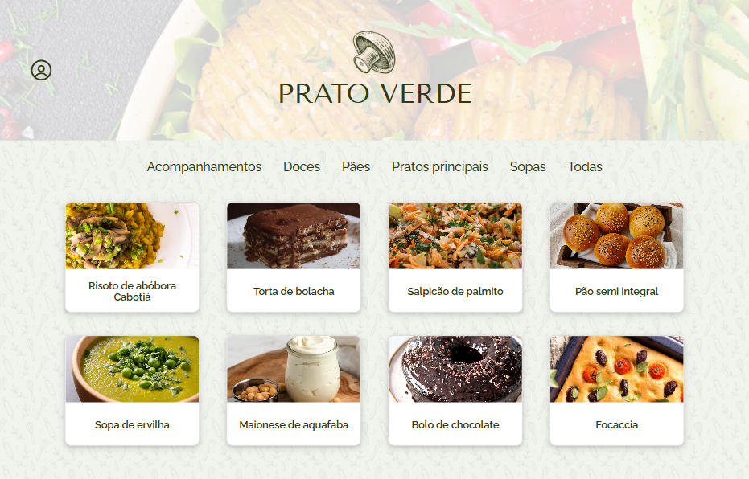

# Prato-Verde

### Site de receitas veganas :fork_and_knife::herb:



O Prato Verde é um **site de receitas** com foco em culinária vegana. Ele foi desenvolvido como um projeto de estudo e aplicação prática de **React e Firebase**, com design **responsivo** priorizando a experiência em dispositivos móveis.

O objetivo principal foi criar uma interface completa onde os usuários pudessem **visualizar, interagir e gerenciar suas receitas favoritas** a partir de uma base de dados externa.

## :hammer: Funcionalidades

- Filtrar receitas por categorias;
- Acessar os detalhes de cada receita, com ingredientes e instruções;
- Favoritar, desfavoritar e compartilhar receitas;
- Acessar o perfil do usuário com as receitas favoritas;

## :memo: Etapas do projeto

> :warning: `Clique na seta para ver a lista de cada etapa.`

<details>
  <summary> <b>Tela de Login</b></summary>
  
1. [x] Desenvolver a tela de formulário com input de nome, e-mail, senha e botão de login.
2. [x] O botão do formulário só deve ser habilitado após um nome de usuário e uma senha com 6 caracteres ou mais serem preenchidos.
3. [x] Após a submissão do formulário, salvar no localStorage o nome do usuário na chave `user`.
4. [x] Redirecionar o usuário para a tela principal de receitas após a submissão e validação com sucesso do login.

</details>
<details>
  <summary> <b>Tela principal de receitas</b> </summary>
  
1. [x] Implementar o header contendo os ícones de menu.
2. [x] Redirecionar o usuário para a tela de perfil ao clicar no botão de perfil.
3. [x] Implementar os botões de categoria para serem utilizados como filtro.
4. [x] Implementar o filtro das receitas por meio da API ao clicar no filtro de categoria.
5. [x] Implementar o filtro como um toggle, o qual se for selecionado novamente, o app deve retornar as receitas sem nenhum filtro.
6. [x] Redirecionar o usuário ao clicar no card da receita, para a tela de detalhes, que deve mudar a rota e conter o id da receita na URL.
7. [x] Realizar uma request para a API passando o id da receita que deve estar disponível nos parâmetros da URL.
   
</details>
<details>
<summary> <b>Tela de perfil do usuário</b> </summary>
  
1. [x] Possuir o nome do usuário digitado no login.
2. [x] Implementar 2 botões: um de "Voltar" e um de "Sair".
3. [x] Ao clicar no botão de "Voltar", a rota deve mudar para a tela de início.
4. [x] Ao clicar no botão de "Sair", o localStorage deve ser limpo e a rota deve mudar para a tela de login.
5. [x] Mostrar "Receitas favoritas" e os cards de cada receita, com o botão de "favorito" preenchido e um botão de compartilhar.
6. [x] O botão de compartilhar deve copiar a URL da tela de detalhes da receita para o clipboard.
7. [x] O botão de "desfavoritar" deve remover a receita da lista de receitas favoritas do localStorage e da tela.
8. [x] Ao clicar no card da receita, a rota deve mudar para a tela de detalhes daquela receita.

</details>
<details>
<summary> <b>Tela de detalhes da receita</b> </summary>
  
1. [x] Desenvolver a tela de modo que contenha a imagem da receita, o título, uma lista de ingredientes seguidos pelas quantidades, instruções de preparo, um botão de favoritar e um botão de compartilhar.
2. [x] O botão de favoritar deve ser preenchido quando clicado e a receita ser adicionada à lista de receitas favoritas do localStorage e deve aparecer no perfil do usuário em "Receitas favoritas".
3. [x] O botão de compartilhar deve copiar a URL da tela de detalhes da receita para o clipboard.

</details>

## :computer: Rodando o projeto

Para rodar o repositório é necessário clonar o mesmo e dar o seguinte comando para iniciar o projeto:

- Clone o repositório:

```bash
git clone https://github.com/thaina-lopes/prato-verde.git
```

- Entre no arquivo do projeto

```bash
cd prato-verde
```

- Instale as dependências

```bash
npm install
```

- Inicialize o projeto

```bash
npm start
```

## :green_heart: Autora

<table>
  <tr>
    <td align="center">
      <a href="https://github.com/thaina-lopes">
        <br>
      </a>
    </td>
  </tr>
</table>
